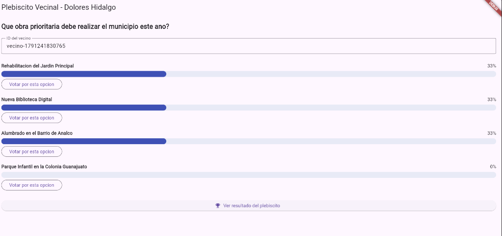
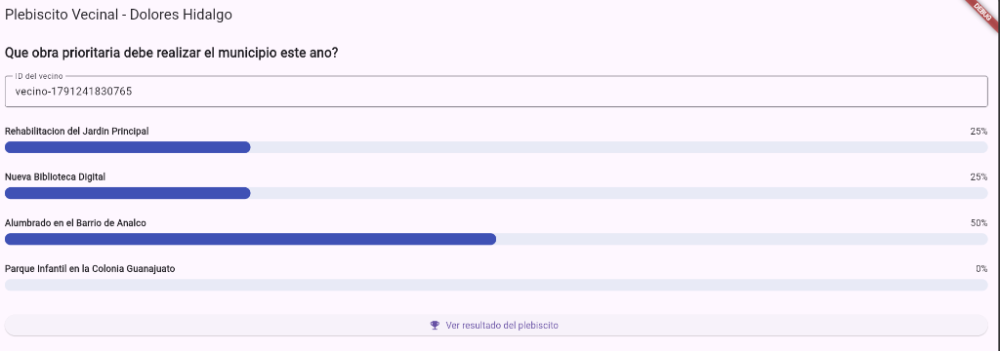
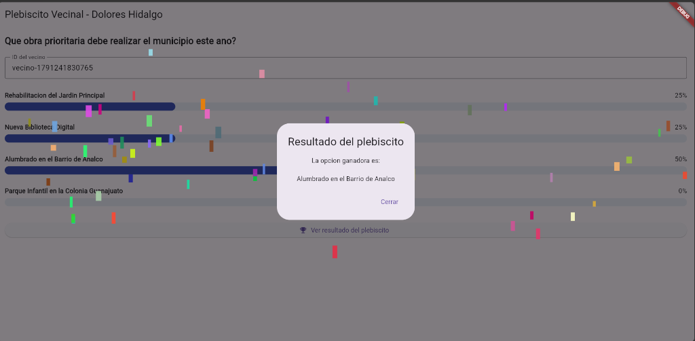
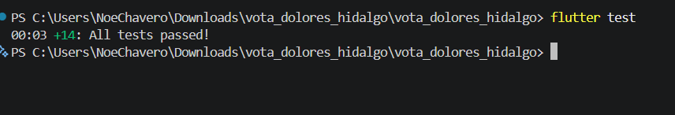
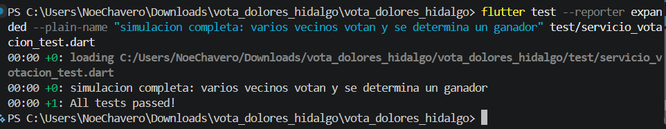

# Vota Dolores Hidalgo

<div align="center">


**Plebiscito vecinal con gráficas animadas, construido 100% con TDD**  
*Desarrollo Móvil Integral — Proyecto complementario de práctica TDD*

**Votación** &nbsp;&bull;&nbsp; **Barras animadas** &nbsp;&bull;&nbsp; **Revelación del ganador con animación y confeti**

</div>

---

## Demostración Visual del Proyecto

| 1. Votación en curso (opciones activas) | 2. Voto registrado y barras actualizadas |
| :---: | :---: |
|  |  |
| *Identificador de vecino asignado, porcentajes en tiempo real y botones de votación disponibles.* | *Al emitir el voto, los botones se deshabilitan/ocultan y las barras crecen con animación fluida.* |

<div align="center">

### Revelación del Ganador con Animación Elástica y Efecto de Confeti
  
*Diálogo con animación elástica (`Curves.elasticOut`), escala y desvanecido, acompañado de renderizado de partículas mediante `CustomPainter`.*

</div>

---

## Evidencia de Pruebas Automatizadas (100% Aprobadas)

| Suite Completa (14 de 14 pruebas) | Prueba de Integración (Simulación Completa) |
| :---: | :---: |
|  |  |
| *Ejecución de `flutter test`: 10 pruebas base del manual más 4 retos de extensión aprobados.* | *Simulación de ciclo de vida completo con múltiples vecinos, bloqueo de votos duplicados y cómputo final.* |

---

## 1. ¿Qué vamos a construir?

**Vota Dolores Hidalgo** es un sistema digital para plebiscitos vecinales. El municipio propone una consulta ciudadana:

> *"¿Qué obra prioritaria debe realizar el municipio este año?"*

Con opciones de infraestructura comunitaria:
- Rehabilitación del Jardín Principal
- Nueva Biblioteca Digital
- Alumbrado en el Barrio de Analco
- Parque Infantil en la Colonia Guanajuato

Los vecinos emiten su voto por su opción preferida. Los resultados se representan en barras horizontales que crecen dinámicamente mediante `TweenAnimationBuilder`. Al consultar el resultado final, se revela la opción ganadora con una transición de escala elástica (`Curves.elasticOut`) y una animación de partículas de confeti.

A diferencia de prototipos básicos, este proyecto implementa y protege **reglas de negocio reales**, idénticas a las requeridas en un sistema formal de votación. Esto lo convierte en un escenario propicio para aplicar **Desarrollo Guiado por Pruebas (TDD)** sobre casos de borde genuinos: prevención de doble voto, votaciones expiradas, empates técnicos y cómputo seguro de porcentajes.

### Reglas de Negocio Protegidas con Pruebas
- **Unicidad del voto:** Cada ciudadano (identificado por un `idUsuario`) puede emitir un único voto por plebiscito.
- **Validación de catálogo:** Únicamente se permite votar por opciones formalmente registradas en la convocatoria.
- **Vigencia temporal:** El sistema rechaza cualquier voto emitido con posterioridad a la fecha límite (`fechaCierre`).
- **Cálculo seguro de porcentajes:** El cómputo de porcentajes es exacto y resistente a divisiones entre cero cuando la votación no registra sufragios.
- **Resolución equitativa de empates:** Si dos o más opciones igualan la votación máxima, el sistema reconoce el empate técnico sin aplicar desempates arbitrarios.
- **Límite de participación:** Control estricto de capacidad máxima (aforo de hasta 500 sufragios).
- **Privacidad y persistencia:** Soporte para modalidad de voto anónimo y persistencia del estado en almacenamiento local.

---

## 2. Estructura del Proyecto

El proyecto adopta un desacoplamiento estricto de responsabilidades, aislando la lógica de dominio en código **Dart puro** independiente del framework de presentación:

```text
vota_dolores_hidalgo/
├── lib/
│   ├── modelos/
│   │   ├── opcion_votacion.dart      # Entidad de la opción y conteo de votos
│   │   ├── votacion.dart             # Entidad raíz del plebiscito y padrón
│   │   └── resultado_opcion.dart     # Objeto de transferencia con opción y porcentaje
│   ├── logica/
│   │   ├── resultado_voto.dart       # Enumeración formal del resultado de la operación
│   │   └── servicio_votacion.dart    # Reglas de negocio y casos de uso
│   ├── presentation/
│   │   ├── confetti_painter.dart     # Pintor personalizado para partículas de confeti
│   │   └── votacion_screen.dart      # Interfaz gráfica y controladores de animación
│   └── main.dart                     # Punto de entrada de la aplicación
├── test/
│   └── servicio_votacion_test.dart   # Batería completa de pruebas unitarias y de integración
└── docs/
    └── images/                       # Evidencias visuales de la aplicación y de la suite de pruebas
```

> [!TIP]
> **Buena Práctica de Arquitectura**  
> Las carpetas `lib/logica/` y `lib/modelos/` contienen exclusivamente código Dart estándar. No dependen de `package:flutter/material.dart`. La capa gráfica reside en `lib/presentation/` y consume la lógica ya validada por la suite de pruebas.

---

## 3. Modelos Base

Se establecen las estructuras de datos fundamentales para modelar el dominio de la votación:

### `lib/modelos/opcion_votacion.dart`
```dart
class OpcionVotacion {
  final String id;
  final String texto;
  int votos;

  OpcionVotacion({
    required this.id,
    required this.texto,
    this.votos = 0,
  });
}
```

### `lib/modelos/votacion.dart`
```dart
import 'opcion_votacion.dart';

class Votacion {
  final String pregunta;
  final List<OpcionVotacion> opciones;
  final DateTime fechaCierre;
  final Set<String> votantes = {};
  final Map<String, String> opcionesPorUsuario = {};

  Votacion({
    required this.pregunta,
    required this.opciones,
    required this.fechaCierre,
  });
}
```

### `lib/modelos/resultado_opcion.dart`
```dart
import 'opcion_votacion.dart';

class ResultadoOpcion {
  final OpcionVotacion opcion;
  final double porcentaje;

  ResultadoOpcion(this.opcion, this.porcentaje);
}
```

### `lib/logica/resultado_voto.dart`
```dart
enum ResultadoVoto {
  exitoso,
  opcionInvalida,
  usuarioYaVoto,
  votacionCerrada,
  maximoVotosAlcanzado,
}
```

> [!NOTE]
> **Decisión de Diseño**  
> Retornar un valor enumerado descriptivo en lugar de lanzar excepciones para flujos predecibles permite a los consumidores del servicio determinar la respuesta visual adecuada sin requerir estructuras `try/catch`.

---

## Manual Paso a Paso con TDD (Rondas 1 a 8)

El desarrollo se condujo bajo el ciclo formal de TDD:
1. **Fase Roja (Red):** Diseñar una prueba unitaria que falle ante la ausencia de implementación.
2. **Fase Verde (Green):** Implementar la solución mínima necesaria para aprobar la prueba.
3. **Fase Refactor (Refactor):** Optimizar la legibilidad y estructura del código preservando el comportamiento funcional.

---

### Ronda 1 — Registrar un Voto Válido

#### Fase Roja — Prueba Unitaria Inicial (Fallo Esperado)
`test/servicio_votacion_test.dart`:
```dart
import 'package:flutter_test/flutter_test.dart';
import 'package:vota_dolores_hidalgo/modelos/opcion_votacion.dart';
import 'package:vota_dolores_hidalgo/modelos/votacion.dart';
import 'package:vota_dolores_hidalgo/logica/resultado_voto.dart';
import 'package:vota_dolores_hidalgo/logica/servicio_votacion.dart';

Votacion _crearVotacionDePrueba({DateTime? fechaCierre}) {
  return Votacion(
    pregunta: 'Pregunta de prueba',
    opciones: [
      OpcionVotacion(id: 'op1', texto: 'Opcion 1'),
      OpcionVotacion(id: 'op2', texto: 'Opcion 2'),
    ],
    fechaCierre: fechaCierre ?? DateTime.now().add(const Duration(days: 7)),
  );
}

void main() {
  test('registrar un voto valido incrementa el contador de esa opcion', () {
    final votacion = _crearVotacionDePrueba();
    final servicio = ServicioVotacion(votacion);

    final resultado = servicio.registrarVoto(idUsuario: 'user1', idOpcion: 'op1');

    expect(resultado, ResultadoVoto.exitoso);
    expect(votacion.opciones[0].votos, 1);
  });
}
```

#### Fase Verde — Implementación Mínima (Prueba Exitosa)
`lib/logica/servicio_votacion.dart`:
```dart
import '../modelos/votacion.dart';
import '../modelos/opcion_votacion.dart';
import 'resultado_voto.dart';

class ServicioVotacion {
  final Votacion votacion;
  ServicioVotacion(this.votacion);

  ResultadoVoto registrarVoto({required String idUsuario, required String idOpcion}) {
    final opcion = _buscarOpcion(idOpcion);
    opcion!.votos++;
    return ResultadoVoto.exitoso;
  }

  OpcionVotacion? _buscarOpcion(String id) {
    for (final o in votacion.opciones) {
      if (o.id == id) return o;
    }
    return null;
  }
}
```

> [!WARNING]
> **Advertencia Técnica:** La expresión `opcion!.votos++` asume forzosamente la existencia de la opción. Si el identificador es erróneo, ocurrirá una excepción en tiempo de ejecución. Este comportamiento se tolera temporalmente en TDD para justificar la siguiente prueba.

---

### Ronda 2 — Rechazar Votos a Opciones Inexistentes

#### Fase Roja — Prueba Unitaria de Validación
`test/servicio_votacion_test.dart`:
```dart
test('votar por una opcion que no existe regresa opcionInvalida', () {
  final votacion = _crearVotacionDePrueba();
  final servicio = ServicioVotacion(votacion);

  final resultado = servicio.registrarVoto(idUsuario: 'user1', idOpcion: 'no-existe');

  expect(resultado, ResultadoVoto.opcionInvalida);
});
```

#### Fase Verde — Corrección de Método
`lib/logica/servicio_votacion.dart`:
```dart
ResultadoVoto registrarVoto({required String idUsuario, required String idOpcion}) {
  final opcion = _buscarOpcion(idOpcion);
  if (opcion == null) return ResultadoVoto.opcionInvalida;

  opcion.votos++;
  return ResultadoVoto.exitoso;
}
```

*La prueba de la Ronda 1 permanece en verde sin requerir alteraciones.*

---

### Ronda 3 — Restringir Duplicidad de Votos

#### Fase Roja — Prueba de Unicidad de Sufragio
`test/servicio_votacion_test.dart`:
```dart
test('un mismo usuario no puede votar dos veces', () {
  final votacion = _crearVotacionDePrueba();
  final servicio = ServicioVotacion(votacion);

  servicio.registrarVoto(idUsuario: 'user1', idOpcion: 'op1');
  final segundoIntento = servicio.registrarVoto(idUsuario: 'user1', idOpcion: 'op2');

  expect(segundoIntento, ResultadoVoto.usuarioYaVoto);
  expect(votacion.opciones[1].votos, 0); // op2 no debio incrementarse
});
```

#### Fase Verde — Registro en el Padrón de Votantes
`lib/logica/servicio_votacion.dart`:
```dart
ResultadoVoto registrarVoto({required String idUsuario, required String idOpcion}) {
  if (votacion.votantes.contains(idUsuario)) return ResultadoVoto.usuarioYaVoto;

  final opcion = _buscarOpcion(idOpcion);
  if (opcion == null) return ResultadoVoto.opcionInvalida;

  opcion.votos++;
  votacion.votantes.add(idUsuario);
  return ResultadoVoto.exitoso;
}
```

> [!TIP]
> **Buena Práctica:**  
> La validación de existencia previa en el padrón se antepone a la comprobación de la opción. Esto impide que un usuario que ya votó sondee la validez de identificadores de opciones del sistema.

---

### Ronda 4 — Cálculo Numérico de Porcentajes

#### Fase Roja — Pruebas de Cómputo y Caso Cero
`test/servicio_votacion_test.dart`:
```dart
test('calcula el porcentaje de cada opcion correctamente', () {
  final votacion = _crearVotacionDePrueba();
  final servicio = ServicioVotacion(votacion);
  servicio.registrarVoto(idUsuario: 'u1', idOpcion: 'op1');
  servicio.registrarVoto(idUsuario: 'u2', idOpcion: 'op1');
  servicio.registrarVoto(idUsuario: 'u3', idOpcion: 'op1');
  servicio.registrarVoto(idUsuario: 'u4', idOpcion: 'op2');

  final resultados = servicio.obtenerResultados();

  final op1 = resultados.firstWhere((r) => r.opcion.id == 'op1');
  final op2 = resultados.firstWhere((r) => r.opcion.id == 'op2');
  expect(op1.porcentaje, 75.0);
  expect(op2.porcentaje, 25.0);
});

test('si no hay ningun voto, todos los porcentajes son 0', () {
  final votacion = _crearVotacionDePrueba();
  final servicio = ServicioVotacion(votacion);

  final resultados = servicio.obtenerResultados();

  expect(resultados.every((r) => r.porcentaje == 0), true);
});
```

#### Fase Verde — Implementación de `obtenerResultados`
`lib/logica/servicio_votacion.dart`:
```dart
List<ResultadoOpcion> obtenerResultados() {
  final total = votacion.opciones.fold<int>(0, (suma, o) => suma + o.votos);
  return votacion.opciones.map((o) {
    final porcentaje = total == 0 ? 0.0 : (o.votos / total) * 100;
    return ResultadoOpcion(o, porcentaje);
  }).toList();
}
```

> [!IMPORTANT]
> Evaluar el caso con 0 votos totales neutraliza la posibilidad de generar `double.nan`. Si se omitiera el control ternario, `0 / 0` produciría valores no numéricos que degradarían la renderización de la interfaz gráfica.

---

### Ronda 5 — Determinación de la Opción Ganadora

#### Fase Roja — Prueba de Mayoría Simple
`test/servicio_votacion_test.dart`:
```dart
test('determinarGanador regresa la opcion con mas votos', () {
  final votacion = _crearVotacionDePrueba();
  final servicio = ServicioVotacion(votacion);
  servicio.registrarVoto(idUsuario: 'u1', idOpcion: 'op1');
  servicio.registrarVoto(idUsuario: 'u2', idOpcion: 'op1');
  servicio.registrarVoto(idUsuario: 'u3', idOpcion: 'op2');

  final ganadores = servicio.determinarGanador();

  expect(ganadores.length, 1);
  expect(ganadores.first.id, 'op1');
});
```

#### Fase Verde — Reducción y Filtro de Votación Máxima
`lib/logica/servicio_votacion.dart`:
```dart
List<OpcionVotacion> determinarGanador() {
  final maxVotos = votacion.opciones.map((o) => o.votos).reduce((a, b) => a > b ? a : b);
  return votacion.opciones.where((o) => o.votos == maxVotos).toList();
}
```

---

### Ronda 6 — Reconocimiento de Empate Técnico

#### Fase Roja — Prueba de Empate Multilateral
`test/servicio_votacion_test.dart`:
```dart
test('si hay empate, determinarGanador regresa mas de una opcion', () {
  final votacion = Votacion(
    pregunta: 'Pregunta de prueba',
    opciones: [
      OpcionVotacion(id: 'op1', texto: 'Opcion 1'),
      OpcionVotacion(id: 'op2', texto: 'Opcion 2'),
      OpcionVotacion(id: 'op3', texto: 'Opcion 3'),
    ],
    fechaCierre: DateTime.now().add(const Duration(days: 7)),
  );
  final servicio = ServicioVotacion(votacion);
  servicio.registrarVoto(idUsuario: 'u1', idOpcion: 'op1');
  servicio.registrarVoto(idUsuario: 'u2', idOpcion: 'op2');
  servicio.registrarVoto(idUsuario: 'u3', idOpcion: 'op3');

  final ganadores = servicio.determinarGanador();

  expect(ganadores.length, 3);
});
```

#### Fase Verde — Confirmación Inmediata
La implementación previa de `determinarGanador` mediante `where()` ya extrae todas las opciones que igualan la cota superior `maxVotos`. La prueba se aprueba sin modificar la base de código.

> [!TIP]
> **Buena Práctica:**  
> Cuando una prueba nueva resulta exitosa inmediatamente, debe conservarse en la suite. Constituye una prueba de regresión permanente que blinda el comportamiento frente a futuras modificaciones.

---

### Ronda 7 — Restricción por Expiración Temporal

#### Fase Roja — Pruebas de Votación Cerrada y Abierta
`test/servicio_votacion_test.dart`:
```dart
test('no se puede votar si la votacion ya cerro', () {
  final votacionCerrada = _crearVotacionDePrueba(
    fechaCierre: DateTime(2000, 1, 1),
  );
  final servicio = ServicioVotacion(votacionCerrada);

  final resultado = servicio.registrarVoto(idUsuario: 'user1', idOpcion: 'op1');

  expect(resultado, ResultadoVoto.votacionCerrada);
  expect(votacionCerrada.opciones[0].votos, 0);
});

test('si la votacion sigue abierta, el voto se registra normalmente', () {
  final votacionAbierta = _crearVotacionDePrueba(
    fechaCierre: DateTime.now().add(const Duration(days: 1)),
  );
  final servicio = ServicioVotacion(votacionAbierta);

  final resultado = servicio.registrarVoto(idUsuario: 'user1', idOpcion: 'op1');

  expect(resultado, ResultadoVoto.exitoso);
});
```

#### Fase Verde — Validación de Fecha Límite
`lib/logica/servicio_votacion.dart`:
```dart
ResultadoVoto registrarVoto({required String idUsuario, required String idOpcion}) {
  if (DateTime.now().isAfter(votacion.fechaCierre)) return ResultadoVoto.votacionCerrada;
  if (votacion.votantes.contains(idUsuario)) return ResultadoVoto.usuarioYaVoto;

  final opcion = _buscarOpcion(idOpcion);
  if (opcion == null) return ResultadoVoto.opcionInvalida;

  opcion.votos++;
  votacion.votantes.add(idUsuario);
  return ResultadoVoto.exitoso;
}
```

---

### Ronda 8 — Refactorización Mediante Guard Clauses

#### Fase Refactor — Claridad Expresiva sin Alterar Comportamiento
Se transforman las condiciones en variables booleanas descriptivas con nombres orientados al dominio:

`lib/logica/servicio_votacion.dart`:
```dart
ResultadoVoto registrarVoto({required String idUsuario, required String idOpcion}) {
  final yaCerro = DateTime.now().isAfter(votacion.fechaCierre);
  if (yaCerro) return ResultadoVoto.votacionCerrada;

  final yaVoto = votacion.votantes.contains(idUsuario);
  if (yaVoto) return ResultadoVoto.usuarioYaVoto;

  final opcion = _buscarOpcion(idOpcion);
  if (opcion == null) return ResultadoVoto.opcionInvalida;

  opcion.votos++;
  votacion.votantes.add(idUsuario);
  return ResultadoVoto.exitoso;
}
```

*Todas las pruebas unitarias se mantienen en verde, confirmando la pureza de la refactorización.*

---

## 4. Prueba de Integración: Plebiscito Completo

Se incluye una prueba de integración exhaustiva que emula el ciclo operativo completo de un plebiscito municipal con múltiples participantes y control de anomalías:

```dart
test('simulacion completa: varios vecinos votan y se determina un ganador', () {
  final votacion = Votacion(
    pregunta: 'Que obra prioritaria debe realizar el municipio?',
    opciones: [
      OpcionVotacion(id: 'jardin', texto: 'Rehabilitacion del Jardin Principal'),
      OpcionVotacion(id: 'biblioteca', texto: 'Nueva Biblioteca Digital'),
      OpcionVotacion(id: 'alumbrado', texto: 'Alumbrado en el Barrio de Analco'),
    ],
    fechaCierre: DateTime.now().add(const Duration(days: 3)),
  );
  final servicio = ServicioVotacion(votacion);

  servicio.registrarVoto(idUsuario: 'vecino1', idOpcion: 'jardin');
  servicio.registrarVoto(idUsuario: 'vecino2', idOpcion: 'jardin');
  servicio.registrarVoto(idUsuario: 'vecino3', idOpcion: 'biblioteca');
  servicio.registrarVoto(idUsuario: 'vecino1', idOpcion: 'alumbrado'); // Intento duplicado rechazado

  final resultados = servicio.obtenerResultados();
  final totalVotos = resultados.fold<double>(0, (s, r) => s + r.opcion.votos);
  final ganadores = servicio.determinarGanador();

  expect(totalVotos, 3);
  expect(ganadores.length, 1);
  expect(ganadores.first.id, 'jardin');
});
```

---

## 5. La Interfaz Gráfica Animada

La pantalla principal (`lib/presentation/votacion_screen.dart`) se construye con animaciones nativas de Flutter, manteniendo total desacoplamiento de las reglas de cálculo:

1. **Barras Animadas:** `TweenAnimationBuilder<double>` interpola suavemente los porcentajes entre el estado anterior y el actual empleando la curva `Curves.easeOutCubic`.
2. **Revelación del Ganador:** Un diálogo modal animado mediante `ScaleTransition` con `Curves.elasticOut` coordinado con `FadeTransition`.
3. **Efecto de Confeti Nativo:** Implementado mediante `CustomPaint` y `ConfettiPainter` en `lib/presentation/confetti_painter.dart`, generando partículas multicolores sin paquetes externos.

---

## 6. Retos de Extensión Implementados

El repositorio incluye la solución técnica y las pruebas correspondientes a los retos de extensión del manual:

### 1. Inyección de Reloj (`DateTime Function() reloj`)
Desacopla la lógica temporal del reloj del sistema, facilitando pruebas deterministas sobre votaciones cerradas en el futuro o pasado.
```dart
test('inyeccion de reloj permite validar cierre de votacion sin depender del sistema', () {
  final votacion = _crearVotacionDePrueba(fechaCierre: DateTime(2030, 1, 1));
  final servicio = ServicioVotacion(
    votacion,
    reloj: () => DateTime(2035, 1, 1),
  );

  final resultado = servicio.registrarVoto(idUsuario: 'vecino-1', idOpcion: 'op1');

  expect(resultado, ResultadoVoto.votacionCerrada);
  expect(votacion.opciones[0].votos, 0);
});
```

### 2. Aforo Máximo de Participantes (Límite de 500 Votos)
Restringe el registro de sufragios adicionales una vez alcanzada la capacidad del plebiscito (`ResultadoVoto.maximoVotosAlcanzado`).
```dart
test('el voto numero 501 se rechaza al superar el maximo de votantes', () {
  final votacion = _crearVotacionDePrueba();
  final servicio = ServicioVotacion(votacion, maxVotos: 500);

  for (var i = 0; i < 500; i++) {
    final resultado = servicio.registrarVoto(idUsuario: 'vecino-$i', idOpcion: 'op1');
    expect(resultado, ResultadoVoto.exitoso);
  }

  final resultado = servicio.registrarVoto(idUsuario: 'vecino-500', idOpcion: 'op2');

  expect(resultado, ResultadoVoto.maximoVotosAlcanzado);
});
```

### 3. Votación Anónima
Permite validar que un usuario ejerció su voto en el padrón sin almacenar la correlación con la opción específica elegida.
```dart
test('la votacion anonima no guarda la opcion elegida por cada usuario', () {
  final votacion = _crearVotacionDePrueba();
  final servicio = ServicioVotacion(votacion, modoAnonimo: true);

  final resultado = servicio.registrarVoto(idUsuario: 'vecino-1', idOpcion: 'op1');

  expect(resultado, ResultadoVoto.exitoso);
  expect(votacion.opciones[0].votos, 1);
  expect(votacion.opcionesPorUsuario.containsKey('vecino-1'), isFalse);
  expect(votacion.votantes.contains('vecino-1'), isTrue);
});
```

### 4. Persistencia con `shared_preferences`
Garantiza la persistencia y recuperación íntegra del estado de las opciones, votos acumulados y votantes registrados.
```dart
test('persistencia con shared_preferences conserva los votos', () async {
  SharedPreferences.setMockInitialValues({});
  final votacion = _crearVotacionDePrueba();
  final servicio = ServicioVotacion(votacion);

  servicio.registrarVoto(idUsuario: 'vecino-a', idOpcion: 'op1');
  await servicio.guardarEstado();

  final votacionRecuperada = _crearVotacionDePrueba();
  final servicioRecuperado = ServicioVotacion(votacionRecuperada);
  await servicioRecuperado.cargarEstado();

  expect(votacionRecuperada.opciones[0].votos, 1);
  expect(votacionRecuperada.votantes.contains('vecino-a'), isTrue);
});
```

---

## Matriz Completa de Pruebas Automatizadas (14 Tests)

| Identificador | Etapa | Descripción de la Prueba | Estado |
| :---: | :---: | :--- | :---: |
| 01 | Ronda 1 | Registrar un voto valido incrementa el contador de esa opcion | Aprobada |
| 02 | Ronda 2 | Votar por una opcion que no existe regresa opcionInvalida | Aprobada |
| 03 | Ronda 3 | Un mismo usuario no puede votar dos veces | Aprobada |
| 04 | Ronda 4 | Calcula el porcentaje de cada opcion correctamente | Aprobada |
| 05 | Ronda 4 | Si no hay ningun voto, todos los porcentajes son 0 | Aprobada |
| 06 | Ronda 5 | DeterminarGanador regresa la opcion con mas votos | Aprobada |
| 07 | Ronda 6 | Si hay empate, determinarGanador regresa mas de una opcion | Aprobada |
| 08 | Ronda 7 | No se puede votar si la votacion ya cerro | Aprobada |
| 09 | Ronda 7 | Si la votacion sigue abierta, el voto se registra normalmente | Aprobada |
| 10 | Integración | Simulacion completa: varios vecinos votan y se determina un ganador | Aprobada |
| 11 | Reto 1 | Inyeccion de reloj permite validar cierre de votacion sin depender del sistema | Aprobada |
| 12 | Reto 2 | El voto numero 501 se rechaza al superar el maximo de votantes | Aprobada |
| 13 | Reto 3 | La votacion anonima no guarda la opcion elegida por cada usuario | Aprobada |
| 14 | Reto 4 | Persistencia con shared_preferences conserva los votos | Aprobada |

---

## Cómo Ejecutar el Proyecto

### 1. Obtener dependencias
```bash
cd vota_dolores_hidalgo
flutter pub get
```

### 2. Ejecutar la suite de pruebas unitarias
```bash
flutter test
```
*Salida esperada:*
```text
00:03 +14: All tests passed!
```

### 3. Ejecutar prueba específica en modo detallado
```bash
flutter test --reporter expanded --plain-name "simulacion completa: varios vecinos votan y se determina un ganador" test/servicio_votacion_test.dart
```

### 4. Iniciar la aplicación
```bash
flutter run
```

---

## Checklist de Cumplimiento TDD

- [x] Reglas de negocio aisladas: Voto único, validación de catálogo, fecha límite y empates cubiertos con pruebas dedicadas.
- [x] Flujo por valores semánticos: `ResultadoVoto` gestiona los casos de borde sin recurrir a excepciones no controladas.
- [x] Resistencia numérica: `obtenerResultados()` previene divisiones entre cero cuando no existen votos registrados.
- [x] Desacoplamiento estricto: `VotacionScreen` no calcula porcentajes ni valida reglas; delega íntegramente a `ServicioVotacion`.
- [x] Prueba de integración end-to-end: Simulación completa con múltiples votantes e intento repetido validada satisfactoriamente.
- [x] Retos de extensión implementados: Inyección de reloj, aforo de 500 votantes, modo anónimo, confeti animado y persistencia en disco.

---

<div align="center">

### Certificación de Dominio Técnico
## Cinturón Negro de Proyecto TDD
*Construcción de un sistema formal de votación con reglas de negocio reales, protegido al 100% por pruebas automatizadas y desacoplado de la interfaz gráfica.*

</div>
